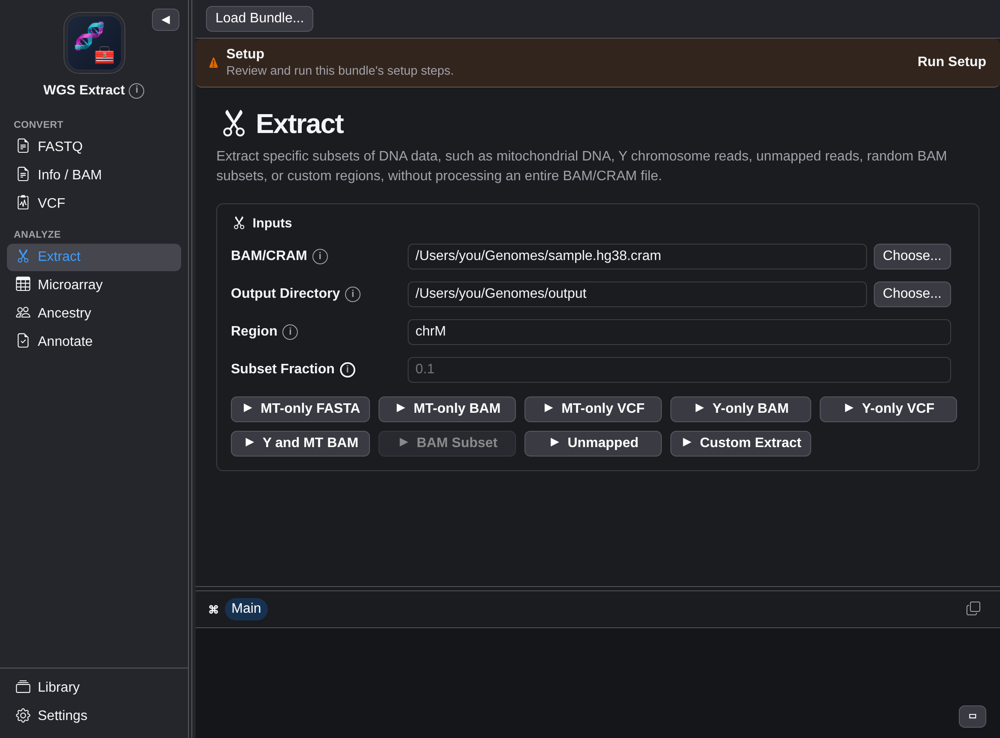

# GUI for CLI

GUI for CLI turns a portable CLI-tool bundle into an installable desktop app for Windows, macOS, and Linux. It is one TypeScript app: a Web UI and a local Node backend, packaged as a native desktop app with [Tauri](https://tauri.app).



The first real app built with GUI for CLI is the WGSExtract interface in `examples/WGSExtract`. It exercises setup steps, long-running commands, dynamic data sources, localization, configuration, terminal output, file pickers, and release packaging against a realistic genomics workflow.

Earlier work, including the SwiftUI macOS app, the Swift CLI, Electron and a dozen experimental renderers, and the benchmarks across them, is preserved on the [`old-experimental`](https://github.com/theontho/gui-for-cli/tree/old-experimental) branch.

## Layout

| Path | Contents |
| --- | --- |
| `app/shared` | Runtime shared by client and server: rendering, localization, types. |
| `app/web/src/server` | Node backend: bundle loading, setup, action execution, config. |
| `app/web/src/client` | Browser UI. |
| `app/web/packagers/tauri` | Tauri desktop shell (Rust): window, menus, native pickers, updater. |
| `examples/` | Example bundles. |
| `resources/` | Built-in localized strings and icon map. |
| `docs/schema/` | JSON Schemas for `manifest.json` and pages. |
| `tools/`, `scripts/` | Python repo tooling: task runner, packaging, localization lint, site builder. |

## Requirements

- Node.js 22 or newer.
- Python 3.11 or newer for repository tooling ([uv](https://docs.astral.sh/uv/) recommended).
- Rust/Cargo and the [Tauri prerequisites](https://v2.tauri.app/start/prerequisites/) for your OS to build the desktop app.

On Windows, `.\make.ps1 setup` installs Python, Node.js, and Rust with winget when they are missing.

## Getting started

```bash
make setup      # npm install, dev identity, git hooks
make precheck   # verify the toolchain
make run        # serve the Web UI at http://127.0.0.1:8787 with examples/WGSExtract
make tauri      # run the desktop app in dev mode
```

On Windows, use `.\make.ps1 <target>` with the same target names.

`make run` and `make dev` take `BUNDLE=<path>` and `PORT=<port>`:

```bash
make dev BUNDLE=examples/GitHelper PORT=9000
```

## Common commands

| Command | Purpose |
| --- | --- |
| `make run` | Build and serve the Web UI in a browser. |
| `make dev` | Serve the Web UI with TypeScript watch and server reload. |
| `make tauri` | Run the Tauri desktop app in dev mode. |
| `make build` / `make build-tauri` | Compile the Web UI / build the desktop app. |
| `make lint` | Typecheck, validate example bundles, lint locales, compile Python tooling, check duplication. |
| `make test` | Run TypeScript and Python tooling tests. |
| `make ci` | Lint and test, as CI does. |
| `make package` | Build Tauri distributables for this host into `out/release/tauri/`. |
| `make package-windows-cross` | Cross-build the Windows installer from macOS or Linux. |
| `make site` | Regenerate the static project site into `site/` from `site_src/`. |
| `make worktree-setup BRANCH=my-feature` | Create a sibling developer worktree, copy local ignored dev config, and run setup. Set `WORKTREE_PATH=...` to override the location. |
| `make worktree-teardown BRANCH=my-feature` | Remove that worktree. Dirty worktrees are refused unless `FORCE=1` is set. |

Every target runs through `tools/tasks.py`, so `python tools/tasks.py <action> [target]` works anywhere.

## Bundles

A bundle is a folder containing `manifest.json`, page files, scripts, and assets. Pass its path with `BUNDLE=<path>`; it defaults to `examples/WGSExtract`. The path can also be a `manifest.json` file or a `.zip`, `.tar`, `.tar.gz`/`.tgz` archive whose root, or single top-level folder, holds `manifest.json` (a gzipped `manifest.json.gz` works too). Archives are extracted to a cache under the system temp folder.

Every load checks the manifest and pages against the rules in `docs/schema`, the setup steps' platform script folders, and tool version files. Check bundles without starting the app:

```bash
npm --prefix app run bundle:validate -- examples/WGSExtract path/to/bundle.zip
```

Bundles can include `strings.toml` and `strings.<language-code>.toml` localization tables next to `manifest.json`. Schema files live in `docs/schema/manifest.schema.json` and `docs/schema/page.schema.json`.

Run a bundle's action test plans with:

```bash
npm --prefix app run bundle:test -- --help
```

## Configuration

Configuration and bundle workspaces are stored in the platform Application Support directory (`~/Library/Application Support` on macOS, `%LOCALAPPDATA%` on Windows, `$XDG_DATA_HOME` on Linux). Set `GUI_FOR_CLI_APP_SUPPORT_NAME` to use a different folder name under that directory for isolated tests or scripts.

## Distribution

`make package` builds the macOS `.app`/`.dmg`, the Linux `.deb`/`.rpm`/`.pkg.tar.zst`/`.AppImage`, or the Windows NSIS installer, depending on the host. Packaging defaults to the bundled WGSExtract app; set `packaging.embedded_bundle_path` and `packaging.app_name` in `.devconfig.toml` to package a different bundle.

Tagged releases build on all three OSes in GitHub Actions, sign and notarize the macOS app, and publish a Tauri updater feed. See [`docs/distribution.md`](docs/distribution.md) for signing, notarization, and self-updates.
